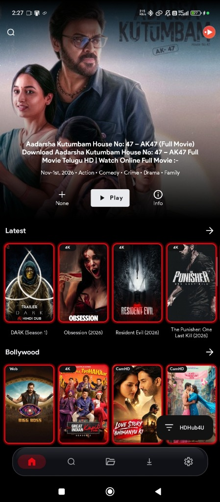
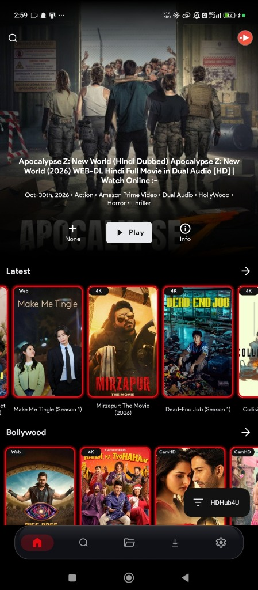
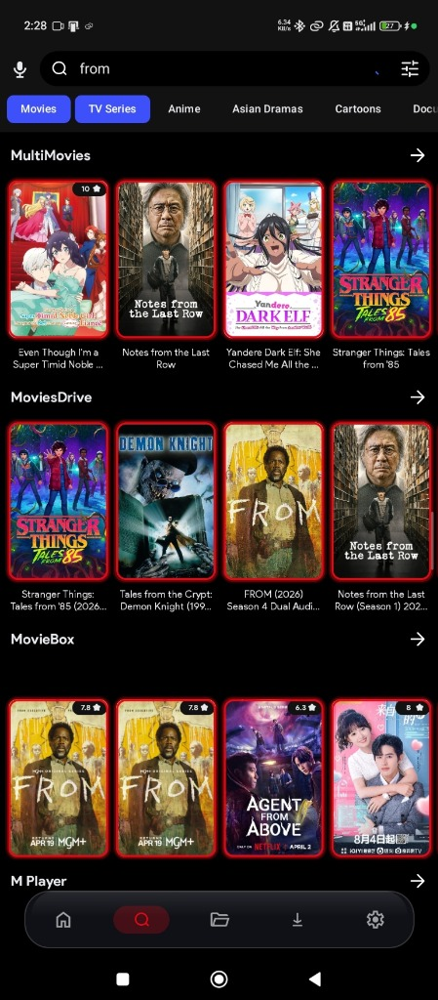
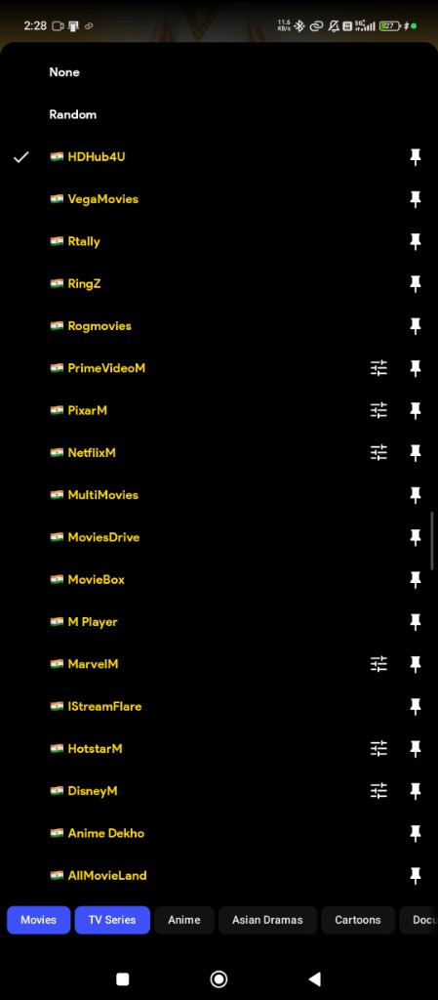
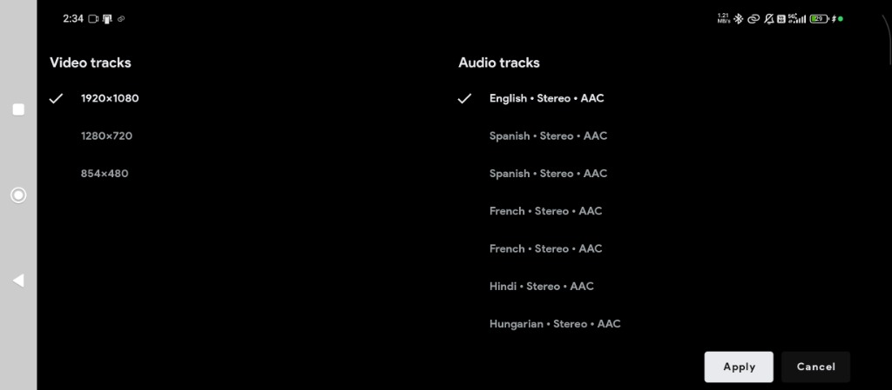

  

  # VerseStream (v1.0)
  ### Official Open-Source Streaming Media Engine | Android, Android TV & Fire TV

  
  
  
  

  

    <b>VerseStream is purely an open-source media player/stream engine, we do not host or upload any media. A high-performance, sleek modern landing page and APK distribution hub for Android phones, Android TV, Fire TV, and PC browsers.</b>
  

---

## 📲 APK Downloads & Builds

Download the latest stable APK release directly from our official portal:

| Package Variant | Architecture / Target | APK Size | Direct Download |
| :--- | :--- | :--- | :--- |
| 🌟 **Universal APK** *(Recommended)* | All Android Phones & TVs | **74.1 MB** | [⬇️ Download VerseStream.apk](https://versestreamapp.com/downloads/universal/VerseStream.apk) |
| ⚡ **64-bit ARM** | `arm64-v8a` (Modern Devices) | **45.1 MB** | [⬇️ Download ARM64 APK](https://versestreamapp.com/downloads/arm64/VerseStream-arm64-v8a-release.apk) |
| 📱 **32-bit ARM** | `armeabi-v7a` (Legacy Devices) | **44.9 MB** | [⬇️ Download ARM32 APK](https://versestreamapp.com/downloads/arm32/VerseStream-armeabi-v7a-release.apk) |
| 💻 **Emulator x86_64** | 64-bit PC / Mac Emulators | **45.6 MB** | [⬇️ Download x86_64 APK](https://versestreamapp.com/downloads/emulator-x86_64/VerseStream-x86_64-release.apk) |
| 🖥️ **Emulator x86** | 32-bit PC Emulators | **45.7 MB** | [⬇️ Download x86 APK](https://versestreamapp.com/downloads/emulator-x86/VerseStream-x86-release.apk) |

---

## 📱 App Screenshots Showcase

  <table>
    <tr>
      <td align="center"><b>Home & Latest Releases</b></td>
      <td align="center"><b>Trending Row</b></td>
      <td align="center"><b>Universal Fast Search</b></td>
      <td align="center"><b>Multi-Server Switcher</b></td>
    </tr>
    <tr>
      <td></td>
      <td></td>
      <td></td>
      <td></td>
    </tr>
  </table>

---

## 🎬 Cinema Player & Audio/Video Engine

  <table>
    <tr>
      <td align="center"><b>Master-Grade 4K TV Cinema Player</b></td>
      <td align="center"><b>Multi-Audio & Video Track Selector</b></td>
    </tr>
    <tr>
      <td></td>
      <td></td>
    </tr>
  </table>

---

## ✨ Core Features

- ⚡ **Multi-Server Switching**: Instant fallback between high-speed streaming routes and cloud mirrors.
- 🔊 **Multi-Track Audio Engine**: Switch easily between multiple language and regional audio tracks.
- 💬 **Live Subtitle Engine**: Online subtitle search with instant offset synchronization.
- 📺 **100% Remote-Friendly on TV**: Fully tailored for Android TV and Firestick D-pad navigation.
- 💾 **Built-in Offline Downloads**: Save media directly to your local storage to watch offline without buffering.
- 🎨 **Adaptive Sunset Coral UI**: Designed with sleek glassmorphism matching the VerseStream brand colors (`#FF385C` → `#FF6B35` → `#FF8A00`).

---

## 🚀 Official Channels & Links

- 🌐 **Official Website**: [https://versestreamapp.com](https://versestreamapp.com)
- 🎬 **Web Stream Portal**: [https://versestreamapp.com](https://versestreamapp.com)
- ✈️ **Telegram Community Channel**: [https://t.me/viewverseofficial](https://t.me/viewverseofficial)
- 📧 **Contact & Support**: [contact@versestreamapp.com](mailto:contact@versestreamapp.com)
- ⚖️ **DMCA Agent**: [dmca@versestreamapp.com](mailto:dmca@versestreamapp.com)

---

## 📄 Legal & Compliance Notice

> **Important Disclaimer:** VerseStream is purely an open-source media player/stream engine, we do not host or upload any media. VerseStream functions strictly as a client-side media playback engine. We do not own, store, or transmit copyrighted files on our servers. All metadata and poster assets are populated via TMDB API under fair-use guidelines. For questions or copyright inquiries, see [terms-of-use.html](terms-of-use.html) and [privacy-policy.html](privacy-policy.html).
